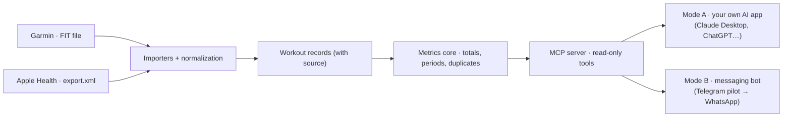

# OpenClock

**Your Garmin and Apple Watch workouts, in a conversation.**

OpenClock brings workout data from Garmin Connect and Apple Watch (Apple Health) into AI assistants through the [Model Context Protocol (MCP)](https://modelcontextprotocol.io/). An assistant such as Claude or ChatGPT can query your workouts, produce reports and explain your progress in plain language, using numbers calculated by OpenClock rather than guessed by the model.

> **Status:** early prototype. Milestone 1 works locally on synthetic sample files: import a Garmin `.fit` and an Apple Health `export.xml`, and get weekly totals per source through the MCP server or the CLI (tested over stdio with the official MCP SDK client; not yet tried in a desktop AI app). Automatic sync with Garmin or Apple and a messaging channel (Telegram or WhatsApp) are still being evaluated.

## Quickstart

Requires Python 3.11+.

```bash
git clone https://github.com/Miguelz80/OpenClock.git && cd OpenClock
python -m venv .venv && source .venv/bin/activate
python -m pip install -e ".[dev]"
openclock summary --data-dir samples --timezone America/Sao_Paulo --week-of 2026-11-18
```

```text
Week 2026-11-16 to 2026-11-22 (America/Sao_Paulo) · sport: running

  source        runs     distance     duration    avg pace
  garmin           1      8.42 km      0:45:10    5:22 /km
  apple_health     1      5.02 km      0:28:45    5:44 /km
  combined         2     13.44 km      1:13:55    5:30 /km
```

And "how did my running change since last week?":

```bash
openclock compare --data-dir samples --timezone America/Sao_Paulo --week-of 2026-11-18
```

```text
  source        metric       previous      current  change
  ...
  combined      workouts            2            2  +0
                distance     10.60 km     13.44 km  +2.84 km (+26.8%)
                duration      0:59:45      1:13:55  +0:14:10
                avg pace     5:38 /km     5:30 /km  8 s/km faster
```

Every number can be traced to a field in [`samples/`](samples/). The [demo guide](docs/demo.md) shows how to check each one by hand. To use OpenClock from an AI assistant, run `openclock-mcp --data-dir <folder> --timezone <zone>` and add it to your MCP client ([docs/mcp.md](docs/mcp.md)).

## Questions OpenClock aims to answer

- How far did I run this week on each device?
- How did my distance, duration and average pace change since last week?
- Which training goal is behind, and what adjustment could I try next week?

Every answer should state the period analysed, where the data came from, and which metrics support the comparison.

## Proposed architecture



- **Importers** read files exported by each platform and convert them into one common record, keeping the original source.
- **Metrics core** computes totals, period boundaries (in the user's time zone) and possible duplicates in plain code, with no AI involved.
- **MCP server** exposes read-only tools (`list_workouts`, `summarize_period`, `compare_periods`), so any MCP-capable assistant can ask for the numbers ([docs/mcp.md](docs/mcp.md)).
- **Channels** are optional layers on top. Mode A costs the project nothing to run because the user brings their own AI app. Mode B adds messaging and AI costs that the operator pays.

See [docs/architecture.md](docs/architecture.md) for the full system design and [docs/adr/](docs/adr/) for the decisions behind it.

## Roadmap

| Milestone | Scope | Status |
|---|---|---|
| 1. Local MCP demo | Synthetic FIT and Apple Health samples, normalization, weekly totals per source, duplicate flagging, tests | Done (local, synthetic data) |
| 2. Comparisons and goals | Average pace, week/month comparison with the previous equivalent period, user goals | In progress: comparisons done, goals next |
| 3. Messaging pilot | Weekly summary and follow-up questions in Telegram | Planned |
| 4. Automatic sync | Garmin API (if access is granted), iOS app or Shortcut for Apple Health, official WhatsApp Business Platform | Under evaluation |

## Data sources at a glance

| Source | How OpenClock reads it today | Notes |
|---|---|---|
| Garmin | `.fit` activity files exported from Garmin Connect (decoded with Garmin's official FIT SDK) | Official API access requires approval and may be paused for new applicants; to be verified. |
| Apple Watch | `export.xml` or `export.zip` from the Health app ("Export All Health Data") | Apple Health has no cloud API; data stays on the iPhone. |
| Strava | Not used | Strava's API agreement prohibits using API data in AI models. See [ADR 0004](docs/adr/0004-data-sources.md). |

## Privacy

Use synthetic data in examples, tests and issues. Keep credentials, GPS routes and personal exports from Garmin Connect or Apple Health out of the repository; the [`.gitignore`](.gitignore) blocks the usual file names. In a messaging pilot, share only the metrics needed for the requested report.

## Contributing

Read [CONTRIBUTING.md](CONTRIBUTING.md) for the branch and pull request workflow and [docs/testing.md](docs/testing.md) for running the checks. Open an [issue](https://github.com/Miguelz80/OpenClock/issues) to suggest a use case, discuss an import format or report a problem, ideally with a synthetic, reproducible example and the expected result.

## License

[MIT](LICENSE)
