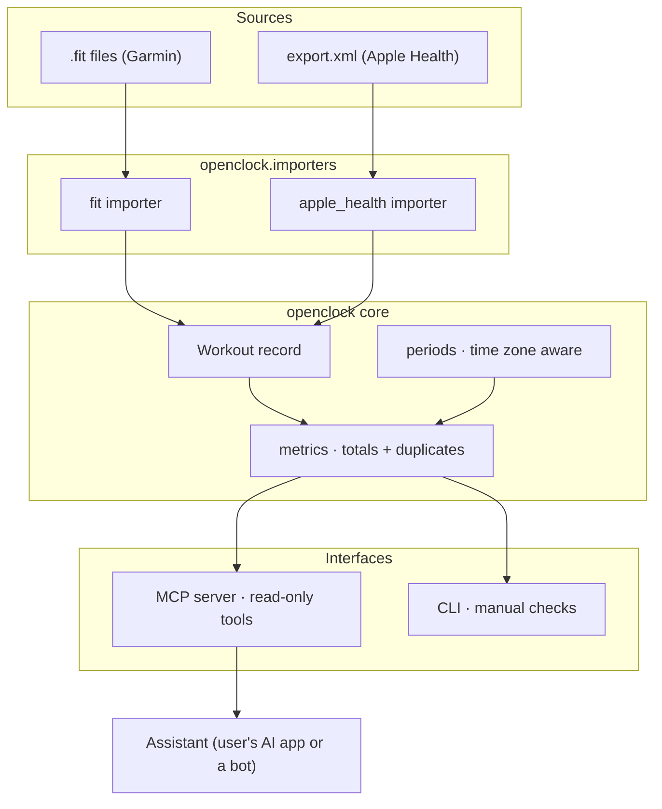

# System design

This document describes how OpenClock is put together and why. Decisions with lasting impact are recorded as [Architecture Decision Records](adr/). This page shows how the pieces fit.

## Goals

1. Answer questions about a person's own training with **traceable numbers**: every total can be reproduced from the source files.
2. Keep the product **free for the user**. Running costs (messaging, AI, hosting, integrations) are assessed separately from the user's price.
3. Keep each layer **independently testable**: importers, metrics, MCP and channels.
4. Respect **privacy**: no real personal data in the repository, and minimal data shared with any channel.

## Non-goals (for now)

- Medical advice. Questions about pain, injury or diagnosis are referred to a professional.
- Training plans generated without the user's stated goals.
- Unofficial integrations: scraping Garmin Connect, unofficial WhatsApp libraries, or reverse-engineered APIs.

## Layers



### 1. Importers

Each importer reads one file format and returns a list of `Workout` records. Importers do not compute totals and know nothing about MCP.

- **Garmin FIT:** decoded with Garmin's official [FIT Python SDK](https://pypi.org/project/garmin-fit-sdk/). One record per `session` message.
- **Apple Health XML:** streamed with `iterparse` (real exports can be hundreds of megabytes) through `defusedxml` to block XML entity attacks. One record per `<Workout>` element. Both the legacy attribute format (`totalDistance`) and the newer `<WorkoutStatistics>` child format are supported.

### 2. Normalized record

| Field | Type | Notes |
|---|---|---|
| `source` | `"garmin"` \| `"apple_health"` | Never lost or merged. |
| `source_id` | string | Stable across re-imports of the same file (see below). |
| `sport` | string | Normalized: `running`, `walking`, `cycling`, `swimming`, `other`. |
| `start` | timezone-aware datetime (UTC) | Converted to the user's time zone only when grouping. |
| `duration_s` | float or `null` | Active (timer) time, pauses excluded. |
| `distance_m` | float or `null` | Meters. |
| `source_file` | string | File the record came from, for traceability. |

Missing metrics are stored as `null` and reported as **unavailable**. They are never treated as zero.

**Stable identifiers.** Re-importing the same file must not change totals, so each record gets a deterministic ID:

- Garmin: `file_id.serial_number` + `file_id.time_created` + session index.
- Apple Health: the export has no workout UUID, so the ID is a hash of activity type, source name, start and end date.

Records are stored by `(source, source_id)`, so a second import of the same data replaces instead of adding.

### 3. Metrics core

- **Periods:** a week runs Monday 00:00 to the next Monday 00:00 (ISO 8601) **in the time zone chosen by the user**. A run at 22:00 on Sunday in São Paulo is 01:00 on Monday in UTC. Grouping by UTC would put it in the wrong week.
- **Totals per source:** count, distance and duration, each summed only over records where the metric is available, plus the number of records missing it.
- **Duplicate detection:** the same run recorded by a Garmin watch and an Apple Watch, or synced from Garmin Connect into Apple Health, would be counted twice. Records from *different* sources whose time ranges overlap substantially are flagged as possible duplicates **before** any combined total is produced. See [ADR 0005](adr/0005-duplicates-and-time-zones.md).

### 4. MCP server

Read-only tools, documented in [docs/mcp.md](mcp.md) once implemented:

- `list_workouts`: workouts in a period, with source and missing metrics.
- `summarize_period`: totals per source for a week or a custom date range, possible duplicates, and a combined total only when it is safe.

The assistant is instructed to use these tools as the source of every number, state the period and source, and point out missing or stale data.

### 5. Channels (later milestones)

| Mode | How it works | Who pays for AI | Messaging cost |
|---|---|---|---|
| A. Bring your own AI | User adds the OpenClock MCP server to Claude Desktop, ChatGPT or another MCP client | User's existing subscription | None |
| B. Messaging bot | OpenClock runs a bot that calls an LLM with the MCP tools | Operator | Telegram: none. WhatsApp: per template message outside the 24h window |

See [ADR 0003](adr/0003-channel-strategy.md) for why Telegram is the pilot channel and WhatsApp comes later.

## Repository layout (target)

```
src/openclock/
  models.py            # Workout record
  periods.py           # time-zone-aware period boundaries
  metrics.py           # totals and duplicate detection
  store.py             # idempotent in-memory store keyed by (source, source_id)
  importers/
    fit.py             # Garmin FIT
    apple_health.py    # Apple Health export.xml
  synthetic.py         # generator for synthetic sample files
  library.py           # loads a data directory into the store
  mcp_server.py        # MCP tools
  cli.py               # command-line checks
samples/               # synthetic files used by the demo
tests/
docs/
```

## Operating cost model (to be validated)

| Item | Mode A | Mode B (Telegram) | Mode B (WhatsApp) |
|---|---|---|---|
| Hosting | None (runs locally) | Small VPS or serverless | Same |
| AI | User | Operator, per question | Operator, per question |
| Messaging | None | Free | Meta per-message pricing for templates; verify current rates |
| Data integrations | Manual files | Manual files or API | Same |

Real numbers will be collected during the messaging pilot and recorded in an ADR.
