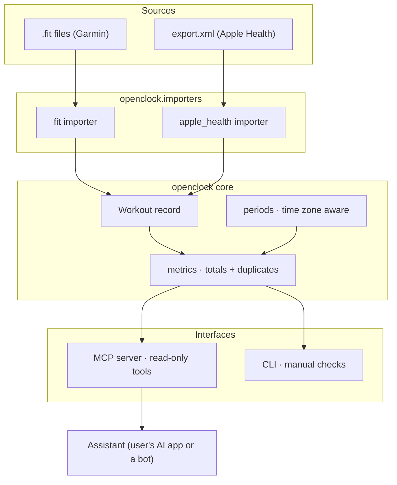

# System design

This document describes how OpenClock is put together and why. Decisions with lasting impact are recorded as [Architecture Decision Records](adr/). This page shows how the pieces fit.

## Goals

1. Answer questions about a person's own training with **traceable numbers**: every total can be reproduced from the source files.
2. Keep the product **free for the user**. Running costs (messaging, AI, hosting, integrations) are assessed separately from the user's price.
3. Keep each layer **independently testable**: importers, metrics, MCP and channels.
4. Respect **privacy**: no real personal data in the repository, and minimal data shared with any channel.

## Non-goals (for now)

- Medical advice. Questions about pain, injury or diagnosis are referred to a professional.
- Training plans generated without the user's stated goals.
- Unofficial integrations: scraping Garmin Connect, unofficial WhatsApp libraries, or reverse-engineered APIs.

## Layers



### 1. Importers

Each importer reads one file format and returns a list of `Workout` records. Importers do not compute totals and know nothing about MCP.

- **Garmin FIT:** decoded with Garmin's official [FIT Python SDK](https://pypi.org/project/garmin-fit-sdk/). One record per `session` message. Garmin Connect `.zip` downloads, including the account export with zips inside a zip, are opened in memory with size limits. A `.zip` is treated as an Apple Health export only if it contains `export.xml`.
- **Apple Health XML:** streamed with `iterparse` (real exports can be hundreds of megabytes) through `defusedxml` to block XML entity attacks. One record per `<Workout>` element. Both the legacy attribute format (`totalDistance`) and the newer `<WorkoutStatistics>` child format are supported.

### 2. Normalized record

| Field | Type | Notes |
|---|---|---|
| `source` | `"garmin"` \| `"apple_health"` | Never lost or merged. |
| `source_id` | string | Stable across re-imports of the same file (see below). |
| `sport` | string | Normalized: `running`, `walking`, `cycling`, `swimming`, `other`. |
| `start` | timezone-aware datetime (UTC) | Converted to the user's time zone only when grouping. |
| `duration_s` | float or `null` | Active (timer) time, pauses excluded. |
| `distance_m` | float or `null` | Meters. |
| `source_file` | string | File the record came from, for traceability. |

Missing metrics are stored as `null` and reported as **unavailable**. They are never treated as zero.

**Stable identifiers.** Re-importing the same file must not change totals, so each record gets a deterministic ID:

- Garmin: `file_id.serial_number` + `file_id.time_created` + session index.
- Apple Health: the export has no workout UUID, so the ID is a hash of activity type, source name, start and end date.

Records are stored by `(source, source_id)`, so a second import of the same data replaces instead of adding.

### 3. Metrics core

- **Periods:** a week runs Monday 00:00 to the next Monday 00:00 (ISO 8601) **in the time zone chosen by the user**. A run at 22:00 on Sunday in São Paulo is 01:00 on Monday in UTC. Grouping by UTC would put it in the wrong week.
- **Totals per source:** count, distance and duration, each summed only over records where the metric is available, plus the number of records missing it.
- **Average pace:** total duration ÷ total distance over workouts that have both metrics (distance > 0). Longer runs therefore weigh more than in a mean of per-run paces, and the response says how many workouts the pace is based on.
- **Comparisons:** a period is compared only with its equivalent predecessor: week with the previous ISO week, month with the previous calendar month, a custom range with the same number of days before it. See [ADR 0007](adr/0007-comparisons-and-pace.md).
- **Duplicate detection:** the same run recorded by a Garmin watch and an Apple Watch, or synced from Garmin Connect into Apple Health, would be counted twice. Records from *different* sources whose time ranges overlap substantially are flagged as possible duplicates **before** any combined total is produced. See [ADR 0005](adr/0005-duplicates-and-time-zones.md).

### 3b. Goals

`openclock.goals` evaluates goals the **user** sets: a metric (`distance_km`, `duration_min`, `workout_count`, `avg_pace`, `longest_km`), a target and a period (`week` or `month`). Goals come from `goals.toml` in the data folder, or are passed by the assistant after the user states them. OpenClock never invents a goal.

- **Status** compares the actual value with the target. For totals in a period still in progress, it also compares with a **pro-rata** target (target × elapsed fraction), giving `on_track` or `behind`.
- `as_of` fixes "now", and workouts after it are ignored, so results are reproducible.
- **History** evaluates the same goal over previous equivalent periods. Periods before the first imported workout are `no_data`, not zero.
- Suggestions stay with the assistant. The tool returns the numbers a suggestion must cite. See [ADR 0008](adr/0008-goals.md).

### 4. MCP server

Read-only tools, documented in [docs/mcp.md](mcp.md):

- `list_workouts`: workouts in a period, with source and missing metrics.
- `summarize_period`: totals and average pace per source for a week, month or custom date range, possible duplicates, and a combined total only when it is safe.
- `compare_periods`: changes in count, distance, duration and pace against the equivalent previous period.
- `goal_progress`: progress towards user goals, with status, what remains and recent history.

The assistant is instructed to use these tools as the source of every number, state the period and source, and point out missing or stale data.

The tools are thin wrappers around `openclock.service`, which the CLI also uses and future chat channels will use. Every interface therefore returns identical numbers. `openclock.library` scans a data folder, re-parses only changed files and rebuilds the store, so dropping a new export into the folder is enough.

### 5. Channels

| Mode | How it works | Who pays for AI | Messaging cost |
|---|---|---|---|
| A. Bring your own AI | User installs OpenClock and adds `openclock-mcp` to Claude Desktop, Claude Code or another MCP client ([guide](mcp.md#mode-a-install-in-your-own-ai-app)) | User's existing subscription | None |
| B. Telegram bot | `openclock-telegram`: commands answered without AI; free-form questions answered by Claude with the same MCP tools ([guide](telegram.md)) | Operator, per free-form question | None on Telegram |
| B'. WhatsApp | `openclock-whatsapp`: official Cloud API webhook; same chat core; weekly report as an approved template ([guide](whatsapp.md)) | Operator, per free-form question | Per template message (weekly push); check Meta's current rates |

`openclock.assistant` connects to the MCP server **in-process**, so Mode A and Mode B use identical tools. `openclock.channels.core` holds what every chat channel shares: the allowlist, commands, reports, conversations and usage logging. `openclock.channels.messages` formats reports in pt-BR or English. `telegram.py` and `whatsapp.py` only move text in and out. See [ADR 0003](adr/0003-channel-strategy.md), [ADR 0009](adr/0009-telegram-bot.md) and [ADR 0010](adr/0010-whatsapp-adapter.md).

## Repository layout

```
src/openclock/
  models.py            # Workout record
  periods.py           # time-zone-aware period boundaries
  metrics.py           # totals and duplicate detection
  store.py             # idempotent in-memory store keyed by (source, source_id)
  importers/
    fit.py             # Garmin FIT
    apple_health.py    # Apple Health export.xml
  synthetic.py         # generator for synthetic sample files
  goals.py             # user goals and progress
  report.py            # JSON views, units and rounding
  library.py           # loads a data directory into the store
  service.py           # read-only queries shared by MCP, CLI and channels
  mcp_server.py        # MCP tools (stdio)
  cli.py               # command-line checks
  assistant.py         # Claude tool loop over the in-process MCP tools (Mode B)
  channels/
    core.py            # shared chat logic: allowlist, commands, reports, conversations, usage
    messages.py        # report text for chats (pt-BR / English), no AI
    telegram.py        # Telegram transport (long polling)
    whatsapp.py        # WhatsApp Cloud API transport (signed webhook, weekly template)
samples/               # synthetic files used by the demo
tests/
docs/
```

## Operating cost model (to be validated)

| Item | Mode A | Mode B (Telegram) | Mode B (WhatsApp) |
|---|---|---|---|
| Hosting | None (runs locally) | Small VPS or serverless | Same |
| AI | User | Operator, per question | Operator, per question |
| Messaging | None | Free | Meta per-message pricing for templates; verify current rates |
| Data integrations | Manual files | Manual files or API | Same |

Real numbers will be collected during the messaging pilot and recorded in an ADR.
